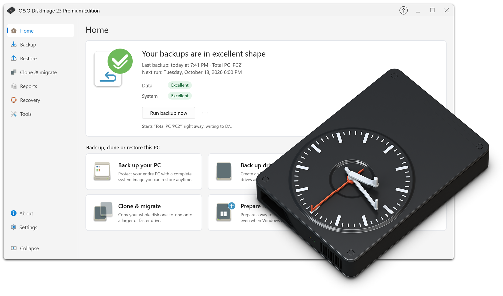
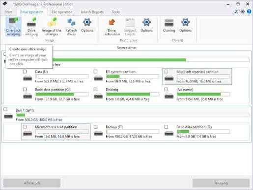

# O&O DiskImage for Windows Backup and Recovery

O&O DiskImage helps Windows users preserve a recoverable copy of their computer, selected drives, or important files.
This repository collects product notes and selected imaging references for planning backup and recovery work.

[](https://o-o-diskimage-premium.github.io/O-O-DiskImage/)

## About

O&O DiskImage Premium combines drive imaging, file backup, and disk cloning in a graphical Windows application.
A system image preserves a point in time that can be useful after a failed upgrade, damaged installation, or drive replacement.
File backups serve a different purpose: recovering selected documents without replacing the complete system.

This is an independent reference repository about the commercial application developed by O&O Software GmbH.
The bundled scripts come from Clonezilla and retain their original project identity and licensing.
They are study materials for related imaging tasks and are separate from the O&O DiskImage application.

Searches for **o&o diskimage premium** often concern complete PC protection and recovery media.
The broader **o&o diskimage** name also covers workflows involving individual drives, partitions, and files.

## Features

| Task | O&O DiskImage capability | Planning consideration |
| --- | --- | --- |
| Preserve a Windows installation | System and drive imaging | Include the partitions needed for startup |
| Protect selected documents | File and folder backup | Choose a scope that matches daily work |
| Replace a storage device | Direct disk cloning | Identify the destination before writing |
| Keep successive recovery points | Incremental and differential backups | Preserve the required base and dependent backups |
| Recover an unbootable computer | Bootable recovery media | Test access to the backup destination |
| Move a saved system | Hardware-independent restoration | Check target storage and driver requirements |
| Work with virtual disks | VHD and VHDX support | Match the format to the intended workflow |
| Keep another backup location | Additional cloud destination | Review transfer completion and access credentials |

A clone is a direct copy to another drive; an image is stored as backup files for later restoration.
Choose between them according to whether the goal is immediate drive replacement or a retained recovery point.

The official documentation distinguishes drive-image files in OMG format from file backups in OBK format.
VHD and VHDX are virtual-disk formats with their own usage and compatibility requirements.
Keep the intended restoration method with the backup record instead of relying on the filename alone.

Incremental backups depend on earlier backup data.
A differential backup stores changes relative to a full backup.
Treat each recovery chain as a set when moving or retaining its files.

For storage planning, record:

- The source computer and selected backup scope.
- The physical device holding the backup destination.
- The recovery point date and its purpose.
- Any dependent backup files needed for restoration.
- The last successful recovery-media boot test.

**o&o disk image** and **oo diskimage** are alternate search spellings used in this reference.
**o&o diskimage professional** is another edition-related search phrase; confirm the installed edition before following feature-specific instructions.

## Screenshots



A useful backup overview should make the source, destination, and most recent recovery point easy to distinguish.
When adding an actual screenshot, remove personal folder names, device identifiers, and account details where appropriate.

## Examples

**Inspect disks before planning a clone.**
Windows PowerShell provides a separate Storage module for viewing attached disks.
This read-only example lists disk identities and capacity; it does not start an O&O DiskImage operation.

```powershell
Get-Disk |
    Select-Object Number, FriendlyName, SerialNumber, PartitionStyle,
        @{Name='SizeGiB'; Expression={[math]::Round($_.Size / 1GB, 1)}} |
    Format-Table -AutoSize
```

Match the source and destination using more than capacity alone.
Similar drives may have the same model name, and disk numbers can change between Windows and a recovery environment.
Record the serial number when it is available and compare the device layout before restoring.

The bundled Clonezilla references cover related disk-identification concepts:

- [ocs-blk-dev-info](bin/ocs-blk-dev-info) gathers block-device information into JSON.
- [ocs-scan-disk](bin/ocs-scan-disk) helps inspect removable-disk discovery in its Linux environment.
- [ocs-pt-size-from-sf](bin/ocs-pt-size-from-sf) reads partition sizes from an sfdisk dump.
- [ocs-pt-512-4k-convert](bin/ocs-pt-512-4k-convert) converts saved partition-table sector geometry.

These scripts require their own environment and dependencies; their output is not an O&O DiskImage backup format.
Use them to study device metadata and partition handling rather than as Windows application components.

**Compare a backup file before and after copying it.**
This Windows PowerShell example uses SHA-256 to compare two existing files.
Replace both example paths with files from the same backup set.

```powershell
$original = Get-FileHash -LiteralPath 'E:\Backups\workstation.omg' -Algorithm SHA256
$copied = Get-FileHash -LiteralPath 'F:\Archive\workstation.omg' -Algorithm SHA256
[pscustomobject]@{
    OriginalSHA256 = $original.Hash
    CopiedSHA256 = $copied.Hash
    Match = ($original.Hash -eq $copied.Hash)
}
```

A matching hash establishes that those two files have matching contents.
It does not establish that a complete backup chain exists or that the system will boot after restoration.
For a backup split across several files, compare every required part.

Related bundled material illustrates other approaches to checking and transporting image data:

- [mdisks-checksum](samples/mdisks-checksum) demonstrates checksum-aware Clonezilla imaging workflows.
- [gen-torrent-from-ptcl](bin/gen-torrent-from-ptcl) generates torrent metadata from Partclone helper information.

**Review a backup destination with PowerShell.**
Use this separate filesystem check to see the names and sizes of existing backup files.
The example reads folder contents and calculates sizes in GiB.

```powershell
Get-ChildItem -LiteralPath 'E:\Backups' -File |
    Select-Object Name, LastWriteTime,
        @{Name='SizeGiB'; Expression={[math]::Round($_.Length / 1GB, 2)}} |
    Sort-Object LastWriteTime -Descending
```

Compare the newest file timestamp with the most recent successful application job.
A folder listing alone cannot distinguish a completed image from an interrupted operation.
Keep job results and recovery-chain information alongside the storage inventory.



**Prepare for recovery before a system failure.**
Create recovery media through the application and confirm that the intended computer can boot it.
Check whether the recovery environment can access the storage location holding the backup.
For network destinations, keep the connection details available outside the affected Windows installation.

The following Clonezilla samples demonstrate how a different imaging project approaches recovery environments:

- [gen-rec-iso](samples/gen-rec-iso) assembles a recovery ISO in Clonezilla Live.
- [gen-rec-usb](samples/gen-rec-usb) assembles a recovery USB workflow.
- [ocs-get-nic-fw-lst](bin/ocs-get-nic-fw-lst) identifies network firmware requirements inside a chroot.
- [gen-netcfg](samples/gen-netcfg) illustrates network configuration for supported Red Hat-like systems.

These examples do not generate O&O recovery media and do not establish image-format interoperability.
Their value here is in comparing the preparation needed for storage and network access during recovery.

## Notes

Premium-specific Fortress Mode uses an isolated Windows environment for backup work.
The product supports integrating that environment with Windows Recovery Environment or using external boot media.
Plan which recovery route will remain available if the installed Windows system becomes inaccessible.

Additional cloud copies and local copies have different completion times.
After a scheduled backup, review both the local result and the transfer status for any additional destination.
Keep enough information to locate a recovery point without opening the original computer.

For readers studying automation, the bundled Clonezilla materials include:

- [drbl-ocs.conf](conf/drbl-ocs.conf), configuration defaults for Clonezilla and DRBL.
- [custom-ocs](samples/custom-ocs), a custom backup and restore menu example.
- [custom-ocs-1](samples/custom-ocs-1), an example using a network image repository.
- [ocs-cmd-screen-sample](samples/ocs-cmd-screen-sample), a wrapper for a saved command using screen or tmux.

Their settings and shell syntax belong to Clonezilla; they are not O&O DiskImage job configuration.
The scripts are provided for inspection, and several can modify storage when used in their original environment.

For environment identification and coordination, see:

- [ocs-live-ver](bin/ocs-live-ver), which reports the Clonezilla Live version.
- [ocs-socket](bin/ocs-socket), which sends a message to another machine through a socket.

Record the actual recovery software version in a recovery report instead of inferring it from bundled script names.
Before retiring an older backup, confirm that a newer recovery point covers the same required scope.

## Support

Use the [O&O DiskImage product page](https://www.oo-software.com/en/diskimage-backup-your-data) for product capabilities and vendor resources.
The [O&O DiskImage documentation](https://manuals.oo-software.com/en/oodiskimage/22/corp/01_about_oo_diskimage.html) explains backup terminology and formats for version 22.
Consult documentation matching the installed version when menu labels or available features differ.

When reporting a recovery problem, include the application version, backup type, destination, and relevant job result.
For the bundled Clonezilla references, direct project-specific questions to the Clonezilla maintainers.

## License

O&O DiskImage is commercial software governed by its vendor license terms.
The included Clonezilla material retains its upstream licensing and attribution requirements.
Publishing these reference files does not grant rights to redistribute the O&O DiskImage application.

## Related Search Terms

o&o diskimage premium, o&o diskimage, o&o disk image, oo diskimage, o&o diskimage professional, backup, backup-solution, backup-tool, disk-imaging, disk-cloning, bare-metal, recovery-tools, windows, disaster-recovery, data-protection
